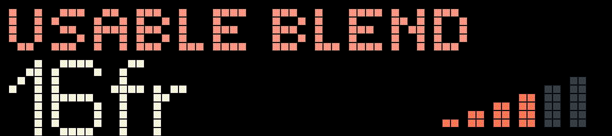

# Edit Handles

Find the longest centered dissolve from the real spare frames on either side of an edit.

Check a dissolve before moving a cut in the editor. The shorter handle limits a centered transition even when there are plenty of frames on the other side.

## Read the centered limit

1. Count the spare outgoing tail frames and incoming head frames at the cut. Enter them with the desired transition length and frame rate in the wheel editor.
2. Press **Start** for results. **Centered max** uses twice the shorter handle for an even, centered transition.
3. Turn to **Usable blend** to see the requested length capped at that limit. Check its duration and any shortfall on the rear.


## Test an adjustment at the cut

1. Click to edit the outgoing tail. Turn to change it by a frame, then click to reach the incoming head or desired length.
2. Return to results and browse **Asymmetric max** if shifting alignment is an option. That page sums the two handles.
3. The second clip tries an extra outgoing frame and then restores the original eight before returning to the limit.



## Example from the emulator

With eight tail frames and fourteen head frames, a centered blend can use 16 frames. A 24-frame request is eight frames short. At 25 fps the usable 16 frames take 0.64 seconds. Shifting the alignment allows up to 22 frames in total.

## Run in the emulator

Open BUSY Bar Emulator. From this repository, run:

```sh
~/.busy-emulator/bin/busy-emulator dev --once
```

Press **Back** to exit.

The GIFs are excerpts from the emulator recording. Each front-display pixel is shown at 9× its original width and height. The end frames pause for reading.

[Full recording](media/controls.mp4) · [Rear display](screenshots/back-1.png) · [Firmware test](EMULATOR-QA.md) · [MIT license](LICENSE)
